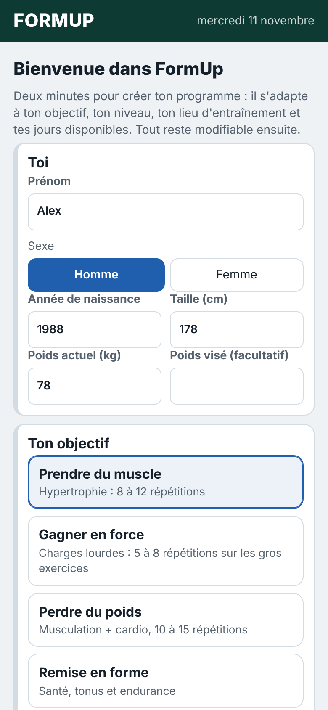
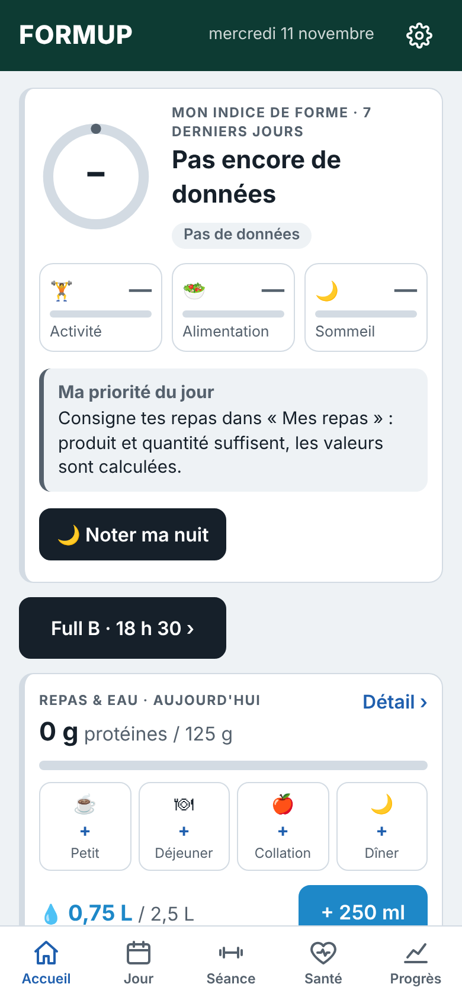
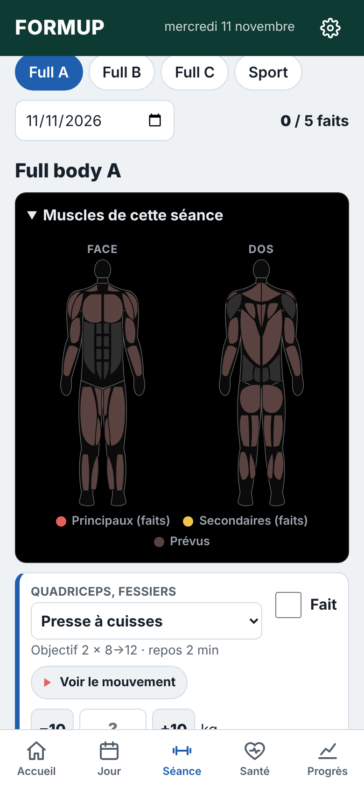
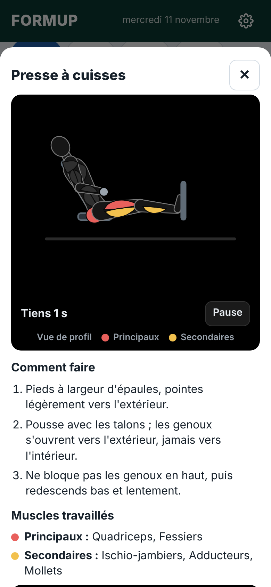

<h1 align="center">FormUp</h1>

<b>Ton programme de musculation créé pour toi en 2 minutes, et ton suivi forme au même endroit : séances, sommeil, eau et repas.</b>

  <a href="https://github.com/orfeo971/formup/releases/latest/download/FormUp.apk"><b>⬇ Télécharger FormUp pour Android</b></a> 
  Gratuit · sans compte · sans publicité · Android 8 ou plus récent

 ou scanne ce QR code avec ton téléphone

## Installer en 3 étapes

1. **Télécharge** : touche le lien ci-dessus sur ton téléphone Android, ou scanne le QR code.
2. **Ouvre le fichier** « FormUp.apk ». La première fois, Android demande d'autoriser l'installation depuis cette source : accepte.
3. **Réponds à l'assistant** : objectif, niveau, salle ou maison, jours. FormUp crée ton programme et ton planning.

## En images

## Ce que fait FormUp

- 🏋 **Un programme pour toi** : prise de muscle, force, perte de poids ou remise en forme, débutant ou confirmé, en salle ou à la maison.
- 📈 **La bonne charge à chaque séance** : une répétition de plus, ou le palier suivant quand toutes les séries sont réussies.
- ▶ **Les mouvements animés**, muscles en couleur, avec les consignes.
- ⏱ **Minuteurs de repos** avec bip et vibration.
- 🌙 **Sommeil**, 💧 **eau** (même écran verrouillé), 🥗 **repas et protéines**.
- ★ **Indice de forme** sur 100 : activité, alimentation, sommeil.

## Questions fréquentes

- **Faut-il un compte ?** Non. Tes données restent sur ton téléphone.
- **« Source inconnue » ?** FormUp n'est pas (encore) sur le Play Store : Android demande ton accord une seule fois. C'est normal.
- **Nouvelles versions ?** Depuis l'application : ⚙ Réglages, carte « Mise à jour ». Tes données sont conservées.
- **Coach IA ?** Facultatif, avec ta propre clé API Claude. Sans lui, tout le reste fonctionne.
- **iPhone ?** Pour l'instant, Android uniquement.

[Toutes les versions](https://github.com/orfeo971/formup/releases)
